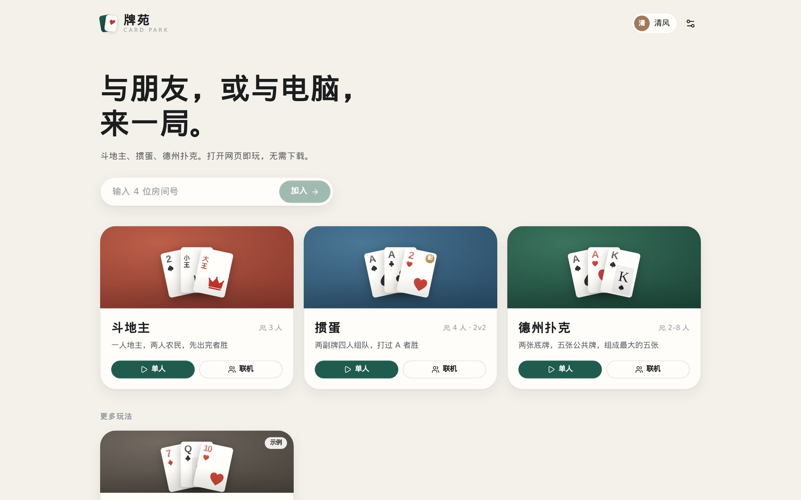
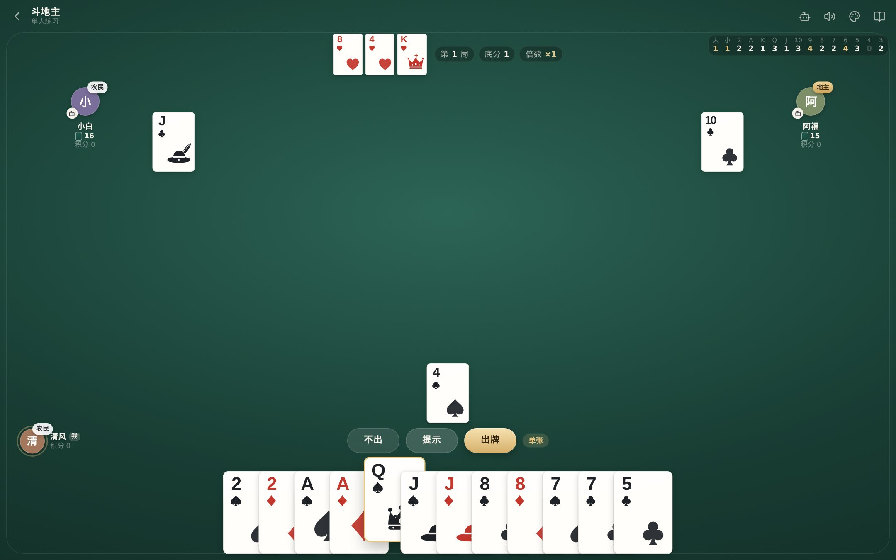
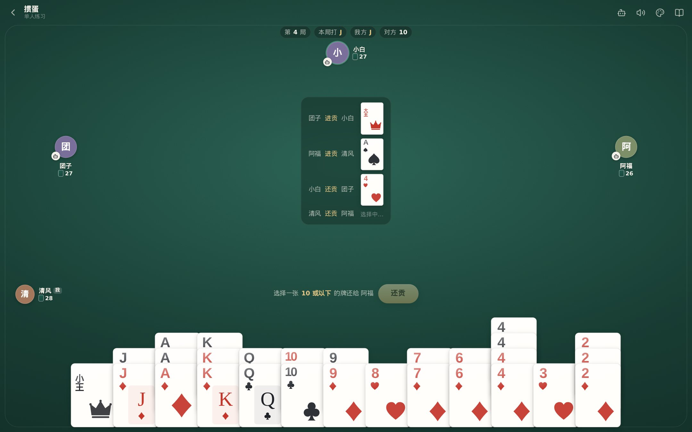
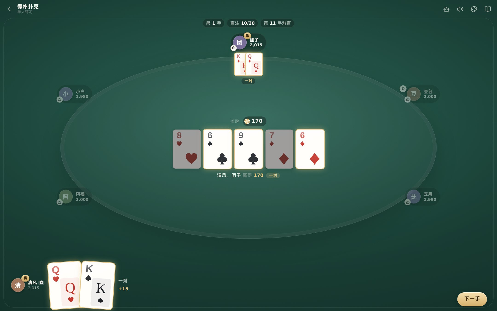
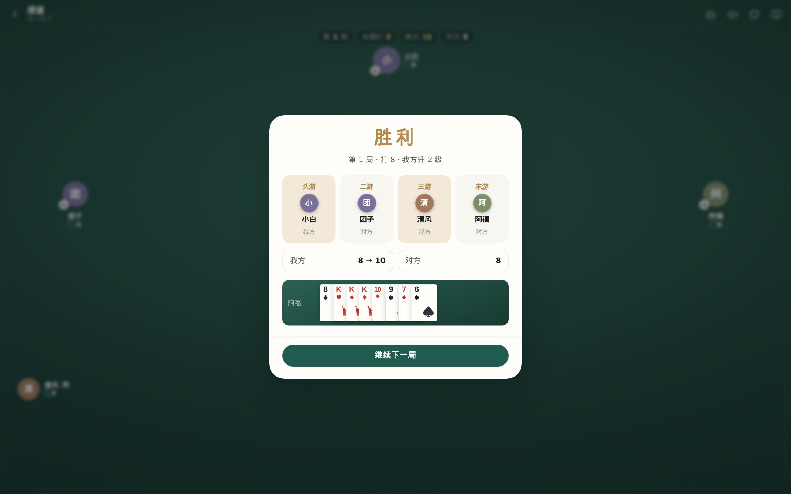
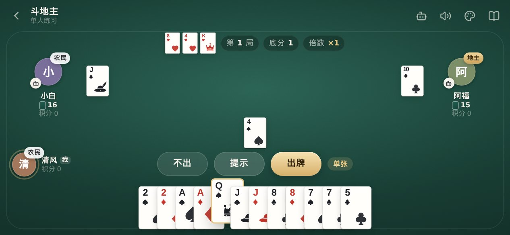

<div align="center">

# 闲亭 · DeskPark

**简洁优雅的网页桌游平台** —— 斗地主、掼蛋、德州扑克、四川麻将（血战到底），单人练习或与好友联机。<br/>
打开网页即玩，规则引擎与界面分离，可扩展自定义卡牌玩法，并为移植 App 预留了结构。

[](https://github.com/solitern/DeskPark/actions/workflows/ci.yml)



</div>

## 特性

- **三大经典玩法**：斗地主（叫分、全牌型、炸弹/春天倍数、记牌器）、掼蛋（两副牌、逢人配、同花顺、升级、进贡/还贡/抗贡、接风）、德州扑克（盲注与涨盲、最小加注规则、边池、摊牌比牌）。
- **单人 & 多人**：单人与电脑对战（启发式 AI，德州使用蒙特卡洛胜率估算）；联机输入 4 位房间号或分享链接即可加入，空位由电脑补齐。
- **服务端权威**：联机时规则在服务器运行，每个座位只收到自己能看到的信息，杜绝作弊；断线重连自动恢复座位，离线/超时自动托管。
- **可扩展玩法**：所有玩法都实现同一个 `GameDefinition` 插件接口，附带示例玩法「比大小」与 [新增玩法指南](docs/ADDING_A_GAME.md)。
- **简洁优雅的界面**：统一的设计令牌、自绘矢量花色与卡面、四种桌布、四色牌、深色模式、细腻的动效与合成音效；桌面与横/竖屏手机自适应。
- **为 App 而设计**：规则引擎纯 TypeScript、无 DOM 依赖；平台相关能力集中在一个适配层，见 [App 移植方案](docs/PORTING.md)。

<table>
  <tr>
    <td></td>
    <td></td>
  </tr>
  <tr>
    <td></td>
    <td></td>
  </tr>
</table>

<p align="center"></p>

## 快速开始

需要 Node.js ≥ 20（推荐 22，见 `.nvmrc`）。

```bash
npm install
npm run dev
```

打开 <http://localhost:5173>。`npm run dev` 会同时启动 Web 开发服务器（Vite）与联机服务器（端口 8787，Vite 已代理 `/ws`）。

> 国内网络安装依赖较慢时，可临时使用镜像：`npm install --registry=https://registry.npmmirror.com`

### 常用命令

| 命令              | 说明                                           |
| ----------------- | ---------------------------------------------- |
| `npm run dev`     | 同时启动 Web 与联机服务器（热更新）            |
| `npm run dev:web` | 只启动 Web（单人模式不需要服务器）             |
| `npm test`        | 运行全部测试（规则单测 + 整局模拟 + 联机集成） |
| `npm run check`   | lint + 类型检查 + 测试，提交前请运行           |
| `npm run build`   | 构建 Web 静态资源与服务器单文件                |
| `npm start`       | 启动生产服务器（同时托管 Web 页面）            |

## 部署

联机服务器会同时托管构建好的网页，因此只需部署一个 Node 进程：

```bash
npm run build
PORT=8787 npm start
```

或使用 Docker：

```bash
docker build -t desk-park .
docker run -p 8787:8787 desk-park
```

环境变量：`PORT`（默认 8787）、`TURN_TIMEOUT_MS`（联机每步时限，默认 30000）、`STATIC_DIR`（网页目录）。
若网页与服务器分开部署，构建网页时设置 `VITE_SERVER_URL=wss://你的域名/ws`。单人模式是纯前端的，可以部署在任意静态托管上。

## 项目结构

```
packages/
  engine/      规则引擎与 AI（纯 TS，无 DOM）：GameDefinition 接口、Table 运行器、各玩法实现
  protocol/    客户端 ⇄ 服务器消息协议
apps/
  web/         React + Vite 网页客户端
  server/      Node WebSocket 联机服务器（房间管理、服务端权威对局）
docs/          架构、设计、玩法扩展、App 移植、路线图
```

## 文档

- [架构说明](docs/ARCHITECTURE.md) —— 分层、数据流、信息隐藏、联机协议
- [新增 / 自定义玩法](docs/ADDING_A_GAME.md) —— 以「比大小」为例的完整步骤
- [设计规范](docs/DESIGN.md) —— 设计原则、色彩、字体、卡面、动效
- [App 移植方案](docs/PORTING.md) —— Capacitor 快速上架与 React Native 原生化路线
- [路线图](docs/ROADMAP.md) · [更新日志](CHANGELOG.md) · [贡献指南](CONTRIBUTING.md)

## 许可

[MIT](LICENSE)
